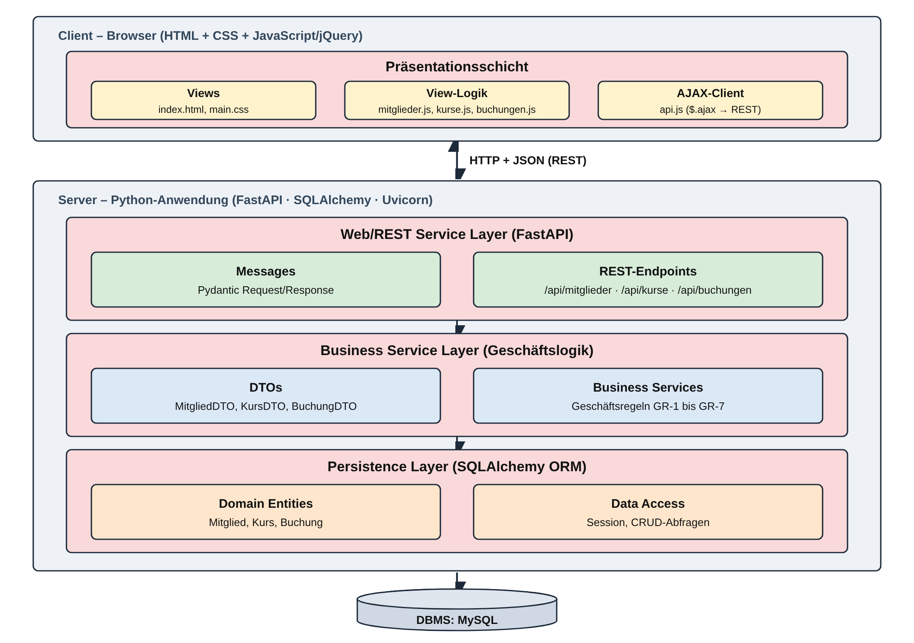
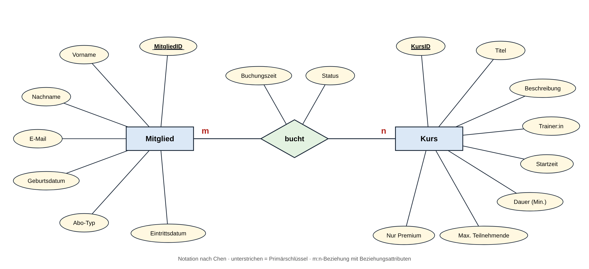

# GymFlow – Webanwendung für ein Fitnessstudio
**Projektbeschreibung: Mitglieder-, Kurs- und Buchungsverwaltung**

Modul «Webbasierte Anwendungen», HS 2026 · Dozent: Marc Schaaf · Team: Carl Klein, Younus Tariq, Ylllind Gashi

## Management Summary

Im Rahmen des Moduls «Webbasierte Anwendungen» entwickelt unser Team die Webanwendung «GymFlow» für ein fiktives Fitnessstudio. Die Anwendung ermöglicht es dem Studiopersonal, Mitglieder und Gruppenkurse (z. B. Yoga, Spinning, HIIT) zu verwalten und Kursbuchungen für Mitglieder zu erfassen und zu stornieren.

Technisch folgt die Anwendung der im Unterricht behandelten Schichtenarchitektur: Eine Präsentationsschicht in HTML, CSS und JavaScript (jQuery) kommuniziert per AJAX mit REST-Services, die mit FastAPI bereitgestellt werden. Die Geschäftslogik (z. B. Kapazitätsprüfung, Premium-Kurse, Stornierungsfrist) ist in einem eigenen Business Layer gekapselt; die Persistenz erfolgt über SQLAlchemy-Entitätsklassen in einer MySQL-Datenbank. Das Datenmodell besteht aus den Entitäten Mitglied und Kurs, die über eine m:n-Beziehung «bucht» verbunden sind, welche als eigene Entitätsklasse Buchung umgesetzt wird.

*Stand 10.11.2026: Konzeptphase. Dieses Dokument beschreibt die geplante Umsetzung und wird im Projektverlauf laufend aktualisiert.*

## 1 Zielsetzung und Szenario

### 1.1 Ausgangslage

Das fiktive Fitnessstudio «GymFlow» bietet neben dem freien Training wöchentlich zahlreiche Gruppenkurse an. Heute werden Mitgliederdaten in einer Tabellenkalkulation geführt und Kursanmeldungen auf Papierlisten am Empfang erfasst. Das führt zu überbuchten Kursen, Doppelanmeldungen und einem hohen administrativen Aufwand. Zudem dürfen bestimmte Kurse nur von Mitgliedern mit Premium-Abo besucht werden, was manuell kaum kontrolliert werden kann.

### 1.2 Zielsetzung

Ziel des Projekts ist eine moderne, browserbasierte Anwendung, mit der das Studiopersonal (Empfang, Studioleitung) Mitglieder, Kurse und Kursbuchungen zentral verwalten kann. Die Anwendung soll die fachlichen Regeln des Studios automatisch durchsetzen und die Kursauslastung jederzeit transparent machen. Gleichzeitig dient das Projekt dazu, die im Unterricht behandelte Schichtenarchitektur (Präsentation, Service Layer, Business Layer, Persistenz) vollständig und sauber getrennt umzusetzen (Schaaf, 2026a).

### 1.3 Funktionaler Umfang

Die Anwendung umfasst folgende Kernfunktionen:

- **Mitgliederverwaltung:** Mitglieder erfassen, anzeigen, suchen, bearbeiten und löschen (CRUD).
- **Kursverwaltung:** Kurse mit Titel, Trainer:in, Startzeit, Dauer und maximaler Teilnehmerzahl erfassen, anzeigen, bearbeiten und löschen (CRUD).
- **Kursbuchung:** Ein Mitglied für einen Kurs anmelden und eine Buchung stornieren.
- **Übersichten:** Freie Plätze und Auslastung pro Kurs, Teilnehmendenliste pro Kurs sowie Buchungsübersicht pro Mitglied.

### 1.4 Technische Rahmenbedingungen

Gemäss den Vorgaben des Moduls gelten folgende technische Anforderungen (Schaaf, 2026a):

- **Web-basiert:** Nutzung in gängigen Browsern (Chrome, Firefox, Safari) ohne Installation.
- **Single-Page-Stil:** Die Seite wird nicht bei jedem Klick neu geladen; Benutzerinteraktionen werden clientseitig in JavaScript verarbeitet, Daten werden per AJAX im Hintergrund geladen.
- **Datenhaltung in einem relationalen DBMS:** MySQL, Zugriff über das ORM von SQLAlchemy.
- **REST-Services:** Alle Funktionen werden über wohldefinierte REST-Endpunkte (HTTP + JSON) mit FastAPI angeboten und sind damit auch für andere Systeme nutzbar.
- **Trennung von Geschäftslogik und Implementationsdetails:** Fachliche Regeln liegen ausschliesslich im Business Layer und sind unabhängig von HTTP und Datenbank-Details.

## 2 Architektur

### 2.1 Schichtenarchitektur

Die Anwendung ist in vier Schichten gegliedert, die jeweils nur mit der direkt darunterliegenden Schicht kommunizieren (Abbildung 1). Die Präsentationsschicht läuft im Browser, alle weiteren Schichten in der Python-Anwendung auf dem Server. Die Abhängigkeiten zwischen den Schichten (z. B. Datenbank-Session, Business Services) werden über die Dependency Injection von FastAPI («Depends») aufgelöst.

*Abbildung 1: Architekturübersicht von GymFlow (eigene Darstellung in Anlehnung an Schaaf, 2026a)*

### 2.2 Projektstruktur

Die Ordnerstruktur im Git-Repository bildet die Schichten direkt ab, damit für alle Teammitglieder klar ist, wo welcher Code hingehört:

| Ordner / Datei | Schicht | Inhalt |
|---|---|---|
| `static/` | Präsentation | index.html, css/main.css, js/*.js (jQuery) |
| `app/web/` | Web/REST Service Layer | FastAPI-Router (Endpoints) und Messages (Pydantic-Modelle) |
| `app/business/` | Business Service Layer | Business Services, DTOs, fachliche Exceptions |
| `app/persistence/` | Persistence Layer | SQLAlchemy-Entitäten, Datenbankverbindung, Repositories |
| `main.py` | Einstiegspunkt | Startet Uvicorn, bindet Router und statische Dateien ein |
| `docs/` | Dokumentation | Projektbeschreibung (Markdown/PDF), ER-Diagramm |

*Tabelle 1: Abbildung der Schichten auf die Projektstruktur*

## 3 Datenmodell

### 3.1 ER-Diagramm

Abbildung 2 zeigt das konzeptuelle Datenmodell in Chen-Notation. Ein Mitglied kann beliebig viele Kurse buchen, und ein Kurs kann von beliebig vielen Mitgliedern gebucht werden (m:n). Die Beziehung «bucht» besitzt eigene Attribute (Buchungszeit, Status).

*Abbildung 2: ER-Diagramm von GymFlow (konzeptuelle Ebene, eigene Darstellung)*

### 3.2 Entitäten und Attribute

Für die Umsetzung wird die m:n-Beziehung in eine eigene Tabelle bzw. Entitätsklasse «Buchung» aufgelöst. Daraus ergeben sich drei SQLAlchemy-Modellklassen (abgeleitet von `DeclarativeBase`):

| Entität | Attribut | Datentyp | Bemerkung |
|---|---|---|---|
| Mitglied | mitglied_id | INT | PK, Auto-Increment |
|  | vorname, nachname | VARCHAR(50) | Pflichtfelder |
|  | email | VARCHAR(100) | Pflichtfeld, UNIQUE |
|  | geburtsdatum | DATE | Für Altersprüfung (GR-5) |
|  | abo_typ | ENUM | BASIC oder PREMIUM |
|  | eintrittsdatum | DATE | Default: Erfassungsdatum |
| Kurs | kurs_id | INT | PK, Auto-Increment |
|  | titel | VARCHAR(80) | z. B. «Yoga Flow» |
|  | beschreibung | TEXT | optional |
|  | trainer | VARCHAR(80) | Name der Kursleitung |
|  | startzeit | DATETIME | Datum und Uhrzeit des Kurses |
|  | dauer_min | INT | > 0 |
|  | max_teilnehmende | INT | > 0, Kapazität (GR-1) |
|  | nur_premium | BOOLEAN | Default: false (GR-3) |
| Buchung | buchung_id | INT | PK, Auto-Increment |
|  | mitglied_id | INT | FK → Mitglied |
|  | kurs_id | INT | FK → Kurs |
|  | buchungszeit | DATETIME | Zeitpunkt der Buchung |
|  | status | ENUM | AKTIV oder STORNIERT |

*Tabelle 2: Entitäten und Attribute des Datenmodells*

In SQLAlchemy werden die Beziehungen über `relationship()` abgebildet: `Mitglied.buchungen` und `Kurs.buchungen` (je 1:n zu Buchung) sowie `Buchung.mitglied` und `Buchung.kurs` (je n:1).

### 3.3 Zentrale Designentscheidungen

- **Auflösung der m:n-Beziehung über eine assoziative Entität:** Da die Beziehung «bucht» eigene Attribute (Buchungszeit, Status) hat, wird sie nicht als reine Verknüpfungstabelle, sondern als vollwertige Entitätsklasse Buchung modelliert. So lässt sich eine Buchung gezielt per REST anlegen und stornieren.
- **Surrogatschlüssel:** Alle Tabellen verwenden technische Auto-Increment-IDs statt natürlicher Schlüssel. Die E-Mail-Adresse kann sich ändern und eignet sich daher nicht als Primärschlüssel; ihre Eindeutigkeit wird über einen UNIQUE-Constraint sichergestellt.
- **Stornierung als Statuswechsel (Soft Delete):** Eine stornierte Buchung wird nicht gelöscht, sondern auf STORNIERT gesetzt. Dadurch bleibt die Historie erhalten und spätere Auswertungen (z. B. Stornoquote) sind möglich.
- **Keine UNIQUE-Regel auf (mitglied_id, kurs_id):** Nach einer Stornierung soll ein Mitglied denselben Kurs erneut buchen können. Doppelbuchungen werden deshalb nicht in der Datenbank, sondern im Business Layer verhindert (GR-2), der den Status berücksichtigt.
- **Keine Speicherung abgeleiteter Werte:** Freie Plätze, Auslastung und Alter werden zur Laufzeit berechnet und nicht gespeichert. So entstehen keine Redundanzen und Inkonsistenzen.
- **Bewusst begrenzter Umfang:** Trainer:innen werden als Attribut des Kurses geführt und der Abo-Typ als Aufzählung (ENUM). Beides könnte später zu eigenen Entitäten ausgebaut werden, ist für den Projektumfang aber nicht nötig.

## 4 Funktionen pro Schicht

Dieses Kapitel beschreibt, welche Aufgaben die einzelnen Schichten übernehmen. Abschnitt 4.5 zeigt anschliessend, in welchem Teil der Architektur die einzelnen Funktionen umgesetzt werden.

### 4.1 Präsentationsschicht (HTML, CSS, JavaScript/jQuery)

- Eine einzige HTML-Seite (`index.html`) mit drei Bereichen: Mitglieder, Kurse und Buchungen. Der Wechsel zwischen den Bereichen erfolgt clientseitig ohne Neuladen der Seite.
- Darstellung der Daten in Tabellen, Formulare zum Erfassen und Bearbeiten sowie Lösch- und Stornierungsbuttons mit Bestätigungsdialog.
- Aufruf der REST-Services per AJAX (`$.ajax`, `$.getJSON`) in einer zentralen Datei `api.js`; Aktualisierung des DOM nach jeder Antwort.
- Clientseitige Eingabeprüfung (Pflichtfelder, E-Mail-Format) dient nur der Benutzerfreundlichkeit. Die verbindliche Prüfung erfolgt auf dem Server.
- Anzeige von freien Plätzen bzw. Auslastung pro Kurs sowie verständliche Anzeige von Fehlermeldungen des Servers (z. B. «Kurs ist ausgebucht»).

### 4.2 Web/REST Service Layer (FastAPI)

Der Service Layer stellt die Geschäftsfunktionen gezielt für die Präsentationsschicht bereit. Er nimmt HTTP-Anfragen entgegen, validiert die JSON-Nachrichten mit Pydantic-Modellen («Messages»), ruft den passenden Business Service auf und übersetzt dessen Ergebnis bzw. fachliche Fehler in HTTP-Antworten (z. B. 201 Created, 404 Not Found, 409 Conflict). Zudem liefert er die statischen Dateien der Präsentationsschicht aus. Geplante Endpunkte:

| Methode | Pfad | Funktion |
|---|---|---|
| GET | /api/mitglieder | Alle Mitglieder abrufen (optional Suche) |
| GET | /api/mitglieder/{id} | Ein Mitglied abrufen |
| POST | /api/mitglieder | Mitglied erfassen |
| PUT | /api/mitglieder/{id} | Mitglied ändern |
| DELETE | /api/mitglieder/{id} | Mitglied löschen |
| GET | /api/kurse | Alle Kurse inkl. freier Plätze abrufen |
| GET | /api/kurse/{id} | Einen Kurs abrufen |
| POST | /api/kurse | Kurs erfassen |
| PUT | /api/kurse/{id} | Kurs ändern |
| DELETE | /api/kurse/{id} | Kurs löschen |
| GET | /api/kurse/{id}/buchungen | Teilnehmendenliste eines Kurses |
| GET | /api/mitglieder/{id}/buchungen | Buchungen eines Mitglieds |
| POST | /api/buchungen | Kurs für ein Mitglied buchen |
| DELETE | /api/buchungen/{id} | Buchung stornieren (Status → STORNIERT) |

*Tabelle 3: Geplante REST-Endpunkte*

### 4.3 Business Service Layer (Geschäftslogik)

Der Business Layer besteht aus den Klassen `MitgliedService`, `KursService` und `BuchungService`. Er arbeitet mit DTOs (Data Transfer Objects) und kennt weder HTTP noch JSON. Verstösse gegen Geschäftsregeln werden als fachliche Exceptions (z. B. `KursAusgebuchtError`) gemeldet. Folgende Geschäftsregeln (GR) werden hier umgesetzt:

| Nr. | Geschäftsregel |
|---|---|
| GR-1 | Kapazität: Eine Buchung ist nur möglich, solange die Anzahl aktiver Buchungen kleiner als max_teilnehmende ist. |
| GR-2 | Keine Doppelbuchung: Ein Mitglied kann denselben Kurs nur einmal aktiv gebucht haben. |
| GR-3 | Premium-Kurse: Kurse mit nur_premium = true können nur von Mitgliedern mit Abo-Typ PREMIUM gebucht werden. |
| GR-4 | Zeitregeln: Nur zukünftige Kurse sind buchbar; eine Stornierung ist bis spätestens 2 Stunden vor Kursbeginn möglich. |
| GR-5 | Mitgliedsdaten: Mindestalter 16 Jahre; die E-Mail-Adresse muss eindeutig sein. |
| GR-6 | Löschschutz: Mitglieder und Kurse mit aktiven, zukünftigen Buchungen können nicht gelöscht werden; max_teilnehmende darf nicht unter die Anzahl aktiver Buchungen gesenkt werden. |
| GR-7 | Kennzahlen: Berechnung von freien Plätzen und Auslastung (in %) pro Kurs. |

*Tabelle 4: Geschäftsregeln im Business Layer*

### 4.4 Persistence Layer (SQLAlchemy, MySQL)

- **Domain Entities:** Die Modellklassen `Mitglied`, `Kurs` und `Buchung` (abgeleitet von `DeclarativeBase`) inklusive Beziehungen und Constraints.
- **Datenbankverbindung:** Konfiguration von Engine und Session; Bereitstellung der Session pro Request über `Depends`.
- **Repositories (Data Access):** Je Entität ein Repository nach dem Repository Pattern (`MitgliedRepository`, `KursRepository`, `BuchungRepository`) mit den Grundmethoden `find_by_id`, `find_all`, `save` und `delete` aus einer gemeinsamen Basisklasse sowie spezifischen Abfragen, z. B. «Anzahl aktiver Buchungen pro Kurs» oder «Buchungen eines Mitglieds».
- Erzeugung des Datenbankschemas aus den Entitätsklassen sowie optionale Testdaten für die Entwicklung.

### 4.5 Zuordnung der Funktionen zur Architektur

Die folgende Übersicht zeigt, welcher Anteil einer Funktion effektiv in welcher Schicht umgesetzt wurde. Angegeben sind jeweils die zuständigen Dateien, Klassen bzw. Methoden. *Stand: umgesetzt, 25.11.2026.*

| Funktion | Präsentation (`static/`) | Service Layer (`app/web/`) | Business Layer (`app/business/`) | Persistenz (`app/persistence/`) |
|---|---|---|---|---|
| Mitglied erfassen / ändern | `mitglieder.js`: Formular, Pflichtfelder und E-Mail-Format per HTML5 | POST /api/mitglieder (201), PUT /api/mitglieder/{id}; `MitgliedRequest` prüft Länge, E-Mail-Muster, Abo-Typ (sonst 422) | `MitgliedService.erstellen` / `aendern`: GR-5 Mindestalter 16 und E-Mail eindeutig (409) | `MitgliedRepository.find_by_email`, `save` (INSERT / UPDATE); UNIQUE-Constraint auf `email` |
| Mitglieder anzeigen / suchen | `mitglieder.js`: Tabelle, Suchfeld | GET /api/mitglieder?suche=…, GET /api/mitglieder/{id} (404) | `MitgliedService.alle` / `nach_id`: Alter berechnen, Entität → DTO | `MitgliedRepository.find_all` (Suche mit ILIKE, sortiert), `find_by_id` |
| Mitglied löschen | Button «Löschen» + Bestätigung | DELETE /api/mitglieder/{id} (204) | `MitgliedService.loeschen`: GR-6 Löschschutz (409) | `MitgliedRepository.delete` (DELETE, alte Buchungen per Cascade) |
| Kurs erfassen / ändern | `kurse.js`: Formular mit `datetime-local`, Zahlen ≥ 1 | POST /api/kurse (201), PUT /api/kurse/{id}; `KursRequest` prüft Dauer und Kapazität > 0 | `KursService.erstellen` / `aendern`: Plausibilität (400), GR-6 Kapazität nicht unter aktive Buchungen (409) | `KursRepository.save` (INSERT / UPDATE), `BuchungRepository.count_aktive` |
| Kurs löschen | Button «Löschen» + Bestätigung | DELETE /api/kurse/{id} (204) | `KursService.loeschen`: GR-6 Löschschutz (409) | `KursRepository.delete` (DELETE) |
| Kurse mit freien Plätzen anzeigen | `kurse.js`: Tabelle mit Auslastungsbalken (grün / orange / rot), Premium-Badge | GET /api/kurse, GET /api/kurse/{id} | `KursService.alle` / `_zu_dto`: GR-7 freie Plätze und Auslastung in % berechnen | `KursRepository.find_all` (nach Startzeit), `BuchungRepository.count_aktive_pro_kurs` (eine Abfrage mit GROUP BY) |
| Kurs buchen | `buchungen.js`: Auswahl Mitglied und Kurs, Button «Buchen», Meldung des Servers | POST /api/buchungen (201); `BuchungRequest` | `BuchungService.buchen`: GR-4 nur zukünftige Kurse, GR-3 Premium, GR-2 keine Doppelbuchung, GR-1 Kapazität (409) | `BuchungRepository.find_aktive`, `count_aktive`, `save` (INSERT) |
| Buchung stornieren | Button «Stornieren» + Bestätigung | DELETE /api/buchungen/{id} (200, gibt die Buchung mit neuem Status zurück) | `BuchungService.stornieren`: GR-4 bis 2 h vor Kursbeginn (409); idempotent | `BuchungRepository.save` (UPDATE Status → STORNIERT, Soft Delete) |
| Teilnehmendenliste / Buchungen eines Mitglieds | `buchungen.js`: Übersicht pro Kurs oder pro Mitglied, Schalter «nur aktive»; Sprung aus Mitglieder- und Kursliste | GET /api/kurse/{id}/buchungen?nur_aktive=…, GET /api/mitglieder/{id}/buchungen | `BuchungService.fuer_kurs` / `fuer_mitglied` | `BuchungRepository.find_by_kurs` / `find_by_mitglied` (sortiert nach Kursbeginn per JOIN; Mitglied und Kurs mit `selectinload` mitgeladen) |
| Fehlerbehandlung (übergreifend) | `allgemein.js`: `zeigeFehler` zeigt die Meldung des Servers an | Zentrale `exception_handler`: `NichtGefunden` → 404, `UngueltigeEingabe` → 400, `GeschaeftsregelVerletzt` → 409; Antwort `{"detail", "code"}` | Fachliche Exceptions mit festem `code` (z. B. `KURS_VOLL`), kein HTTP | Transaktion: Repositories nur `flush()`, `commit()` im Business Service |

*Tabelle 5: Zuordnung der Funktionen zu den Schichten (effektiver Stand)*

**Abweichungen und Ergänzungen gegenüber der Planung:**

- **Repositories:** Der Datenzugriff wurde nach dem Repository Pattern umgesetzt (`MitgliedRepository`, `KursRepository`, `BuchungRepository`). Die Grundmethoden `find_by_id`, `find_all`, `save` und `delete` stehen in einer gemeinsamen Basisklasse `BaseRepository`.
- **Eingabeprüfung in zwei Stufen:** Format und Pflichtfelder prüft der Service Layer mit Pydantic (Antwort 422). Die fachlichen Regeln prüft der Business Layer (Antwort 400 bzw. 409). Die Prüfung im Browser dient nur der Benutzerfreundlichkeit.
- **Zentrale Fehlerübersetzung:** Statt in jedem Endpunkt eine `HTTPException` auszulösen, werden die fachlichen Exceptions einmal zentral in HTTP-Statuscodes übersetzt.
- **Stornieren liefert die Buchung zurück:** Da die Buchung nicht gelöscht wird (Soft Delete), antwortet DELETE /api/buchungen/{id} mit 200 und der Buchung im Status STORNIERT. Ein wiederholter Aufruf hat keinen weiteren Effekt (idempotent).
- **Zusätzlich umgesetzt:** Buchungsübersicht pro Mitglied im GUI, Anzeige stornierter Buchungen (`nur_aktive=false`) sowie eine Darstellung für schmale Bildschirme.
- **Geschäftsregeln nur auf dem Server:** Ausgebuchte oder Premium-Kurse werden in der Auswahl gekennzeichnet, aber nicht gesperrt. Ob gebucht werden darf, entscheidet ausschliesslich der Business Layer.

## 5 Reflexion

### 5.1 Reflexion zur Konzeptphase

Wir haben uns für das Szenario Fitnessstudio entschieden, weil die Domäne allen Teammitgliedern vertraut ist und klare fachliche Regeln bietet. Dadurch enthält die Anwendung nicht nur CRUD-Operationen, sondern echte Geschäftslogik (Kapazität, Premium-Kurse, Stornierungsfrist), mit der sich der Nutzen eines separaten Business Layers gut zeigen lässt.

Die wichtigste Diskussion in der Konzeptphase betraf die Frage, wo welche Regel umgesetzt wird. Beispielsweise könnte die Doppelbuchung auch über einen UNIQUE-Constraint in der Datenbank verhindert werden. Wegen der Stornierung als Statuswechsel haben wir die Regel jedoch bewusst in den Business Layer gelegt. Ebenso haben wir entschieden, Eingaben im Browser nur zur Benutzerfreundlichkeit zu prüfen, da clientseitige Prüfungen umgangen werden können. Um den Umfang beherrschbar zu halten, haben wir das Datenmodell auf drei Entitätsklassen beschränkt und mögliche Erweiterungen (Trainer:innen, Räume, Abos als eigene Entität) bewusst zurückgestellt.

### 5.2 Reflexion nach der Umsetzung

*Nach Projektabschluss ergänzen, z. B.: Was hat gut funktioniert, wo gab es Schwierigkeiten (z. B. SQLAlchemy-Beziehungen, AJAX-Fehlerbehandlung, Zusammenarbeit über Git)? Wurde die Schichtentrennung konsequent eingehalten? Welche Abweichungen vom Konzept gab es und warum? Was würden wir beim nächsten Projekt anders machen?*

## Literaturverzeichnis

- FastAPI. (o. J.). FastAPI Documentation. Abgerufen am 10. November 2026, von https://fastapi.tiangolo.com/
- OpenJS Foundation. (o. J.). jQuery API Documentation. Abgerufen am 10. November 2026, von https://api.jquery.com/
- Schaaf, M. (2026a). Block 3 – Einheit 1: Architekturübersicht und erster Teil Präsentationsschicht [Vorlesungsskript]. Fachhochschule Nordwestschweiz FHNW.
- Schaaf, M. (2026b). Einrichtung Entwicklungsumgebung und Import des Beispielprojekts (Übung 0) [Übungsunterlage]. Fachhochschule Nordwestschweiz FHNW.
- SQLAlchemy. (o. J.). SQLAlchemy 2.0 Documentation. Abgerufen am 10. November 2026, von https://docs.sqlalchemy.org/

## Hilfsmittelverzeichnis

| Hilfsmittel | Verwendung | Betroffene Stellen |
|---|---|---|
| Claude (Anthropic) | Erstellung eines ersten Entwurfs der Projektbeschreibung, des ER-Diagramms, der Architekturgrafik und des Projektgerüsts; Inhalte vom Team geprüft und angepasst | Kapitel 1–5, Abbildungen 1–2 |
| Claude (Anthropic) über Claude Code | Code-Review der Pull Requests zum Business Layer und Service Layer sowie Abgleich des Projekts mit den Unterrichtsunterlagen und den Projektvorgaben; Hinweise vom Team beurteilt, kein Code geändert | – |
| Claude (Anthropic) über Claude Code | Umbau des Datenzugriffs auf das Repository Pattern nach Einheit 3 (Basisklasse `BaseRepository`, Umbenennung der Methoden) und Anpassung der Business Services; per Pull Request vom Team geprüft und übernommen | `app/persistence/repositories.py`, `app/business/services.py` |
| Claude (Anthropic) über Claude Code | Umsetzung der Präsentationsschicht (HTML, CSS, JavaScript/jQuery); per Pull Request vom Team geprüft und übernommen | `static/index.html`, `static/css/main.css`, `static/js/*.js` |
| Claude (Anthropic) über Claude Code | Automatisierte Tests der REST-Endpunkte und des GUI (Abläufe und Geschäftsregeln) vor dem Zusammenführen der Pull Requests | – (Tests nicht im Repository) |
| Claude (Anthropic) über Claude Code | Aktualisierung der Projektbeschreibung auf den umgesetzten Stand; per Pull Request vom Team geprüft und übernommen | Kapitel 2.2 (Tabelle 1), 4.4, 4.5 (Tabelle 5) |
| Playwright | Automatisierter Browser-Test des GUI (durch Claude Code ausgeführt) | – (nicht im Repository) |
| Visual Studio Code | Entwicklungsumgebung | Programmcode |
| Git / GitHub | Versionsverwaltung und Zusammenarbeit im Team | Programmcode |

## Abkürzungsverzeichnis

| Abk. | Bedeutung |
|---|---|
| AJAX | Asynchronous JavaScript and XML |
| API | Application Programming Interface |
| CRUD | Create, Read, Update, Delete |
| CSS | Cascading Style Sheets |
| DBMS | Datenbankmanagementsystem |
| DTO | Data Transfer Object |
| ER | Entity-Relationship |
| FK | Fremdschlüssel (Foreign Key) |
| GR | Geschäftsregel |
| HTML | Hypertext Markup Language |
| HTTP | Hypertext Transfer Protocol |
| JSON | JavaScript Object Notation |
| ORM | Object-Relational Mapping |
| PK | Primärschlüssel (Primary Key) |
| REST | Representational State Transfer |
| SQL | Structured Query Language |
